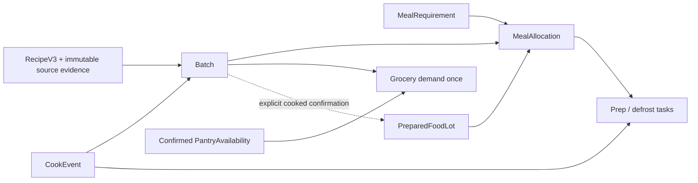

# Recipe Lab 3.0 approved architecture

> **Status:** approved design baseline from issue #16. The recipe-only schema and v2 compatibility layer are described in [V3_IMPLEMENTATION.md](./V3_IMPLEMENTATION.md); the live application still uses v2 and no planner, grocery, pantry, or UI behavior has switched to v3.

## Executive summary

Recipe Lab v3 should separate four facts that the current app necessarily compresses:

1. what a publisher says a recipe produces;
2. how much will be cooked in one batch;
3. how many meal portions are assigned to dated meals; and
4. what food was actually prepared and remains available.

The proposed recipe contract retains every v2 source fact and adds evidence-aware output, nutrition, effort, equipment, component, structured-step, and suitability fields. A minimum-safe recipe remains usable when nutrition or storage facts are unknown. Recommendation and cooking-mode readiness are separate, stricter gates.

The planning model introduces `MealRequirement`, `CookEvent`, `Batch`, `MealAllocation`, and, only after explicit confirmation, `PreparedFoodLot`. Grocery demand is calculated once per batch. A leftover allocation points to the same batch and never buys the recipe twice. Planned food is not actual inventory.

The first implementation should be deterministic domain math and compatibility adapters, not an optimizer. A later optimizer should produce explainable candidates, preserve locks, prefer dinner variety, and normally make lunch from meal prep or suitable prior leftovers.

## Design principles

- Preserve publisher facts verbatim as evidence; put interpretations in separate reviewed fields.
- Unknown is a valid state. Never invent density, yield, nutrition, storage life, or serving size.
- Keep source servings, meal portions, batch output, allocations, and actual inventory in different types.
- Grocery demand follows batches, not the number of times their leftovers appear on the calendar.
- Treat locks, skipped meals, conservation, whole-item output, and safe timing as hard constraints.
- Treat variety, preference, cost, waste, pantry use, effort, and calorie context as explainable soft goals.
- Nutrition informs adequacy but is not a strict recipe-admission gate or exact calorie optimizer.
- Only confirmed pantry quantity offsets shopping. Likely ownership may prompt a check, never a subtraction.
- Public records may contain factual ingredient/yield metadata and independently written summaries; they must not republish copyrighted method prose or photography.

## System boundary



`Batch` is a planned production quantity. `PreparedFoodLot` is actual food and cannot exist merely because a meal was scheduled.

---

## A. Proposed recipe v3 contract

### A.1 Status and evidence vocabulary

Field policy codes used below:

| Code | Meaning |
|---|---|
| `R` | Required for minimum-safe import. |
| `O` | Optional/nullable; absence is represented explicitly. |
| `D` | Deterministically derived from retained facts; never scraped as a new fact. |
| `E` | Later human or rule-based enrichment, with provenance and review status. |
| `FV` | Capture on the first source visit when present so a later revisit is unnecessary. |

```ts
type Confidence = 'reported' | 'reviewed' | 'estimated' | 'uncertain' | 'unknown'
type ProvenanceKind =
  | 'publisher-jsonld'
  | 'publisher-page'
  | 'publisher-nutrition-panel'
  | 'manual-source-review'
  | 'rule-derived'
  | 'editorial-judgment'
  | 'user-entered'

type EvidenceRef = {
  evidenceId: string
  kind: ProvenanceKind
  sourceUrl: string | null
  capturedAt: string | null       // ISO date-time
  sourceLabel: string | null      // short factual location, not copied prose
  confidence: Confidence
  reviewerNote: string | null
}

type Sourced<T> = {
  value: T | null
  evidenceIds: string[]
  confidence: Confidence
  unknownReason: string | null
}
```

Every estimated or editorial value must identify itself. A bare number never silently changes a publisher fact.

### A.2 Typed contract

```ts
type RecipeV3 = {
  schemaVersion: 3

  identity: {
    recipeId: string               // stable UUID retained from v2
    revisionId: string             // immutable revision ID
    slug: string
    title: string
    description: string
    emoji: string | null
    lifecycle: 'draft' | 'source-reviewed' | 'kitchen-tested' | 'retired'
  }

  source: {
    publisher: string
    author: string | null
    canonicalUrl: string
    checkedAt: string              // ISO date
    rating: number | null
    reviewCount: number | null
    selectionRationale: string
    rights: {
      factualMetadataUse: 'review-needed' | 'approved' | 'restricted'
      methodTextUse: 'independent-summary-only' | 'licensed'
      imageUse: 'none' | 'licensed'
      note: string | null
    }
    evidence: EvidenceRef[]
  }

  output: {
    kind: 'flexible-batch' | 'fixed-portions' | 'discrete-items'
    sourceYield: {
      amount: number | null
      range: { min: number; max: number } | null
      unit: string
      label: string
      evidenceIds: string[]
    }
    sourceServing: {
      servingsPerRecipe: number | null
      servingSize: QuantityFact | null
      servingLabel: string | null
      evidenceIds: string[]
    }
    discreteItem: {
      itemName: string
      itemCount: number
      itemsPerSourceServing: number | null
      evidenceIds: string[]
    } | null
    scaling: {
      policy: 'linear-reviewed' | 'whole-items-only' | 'fixed-batch' | 'review-required'
      allowedMultipliers: number[] | null
      note: string | null
    }
    planningGuidance: {
      defaultMealPortions: number | null
      sourceServingsPerMealPortion: Sourced<number> | null
      adequacyNote: string | null
      sideSuggestionRefs: string[]
    }
  }

  components: RecipeComponent[]
  requirements: RecipeRequirementV3[]
  subrecipes: SubrecipeDependency[]
  nutrition: NutritionRecord

  effort: {
    prepMinutes: Sourced<number>
    cookMinutes: Sourced<number>
    passiveMinutes: Sourced<number>
    totalMinutes: Sourced<number>
    activeMinutes: Sourced<number>
    effortLevel: Sourced<'low' | 'medium' | 'high'>
    attentionPattern: Sourced<'mostly-hands-off' | 'periodic' | 'continuous'>
  }

  equipment: EquipmentRequirement[]
  mealRoles: {
    primary: ('breakfast' | 'lunch' | 'dinner' | 'dessert' | 'snack' | 'side')[]
    tags: string[]
  }

  steps: StructuredStep[]
  suitability: SuitabilityRecord

  review: {
    sourceFactsReviewedAt: string
    ingredientCompletenessReviewed: boolean
    methodIndependentlyWritten: boolean
    kitchenTestedAt: string | null
    readiness: {
      minimumSafeImport: boolean
      recommendationReady: boolean
      cookingModeReady: boolean
      blockers: string[]
    }
  }
}

type QuantityFact = {
  amount: number | null
  range: { min: number; max: number } | null
  unit: string
  approximate: boolean
  originalText: string | null
  evidenceIds: string[]
}

type RecipeComponent = {
  componentId: string
  label: string                 // e.g. "sauce", "filling", "for serving"
  order: number
  optional: boolean
  evidenceIds: string[]
}

type RecipeRequirementV3 = {
  requirementId: string         // retain v2 ID
  sourceLineId: string          // retain shared source-line identity
  componentId: string
  originalText: string
  sourceQuantity: QuantityFact | null
  nonQuantified: 'to-taste' | 'as-needed' | 'for-serving' | null
  canonicalIngredientId: string
  variantId: string
  selectedPlanningQuantity: QuantityFact | null
  preparation: string | null
  optional: boolean
  alternatives: IngredientAlternative[]
  scaling: 'linear' | 'whole-item' | 'fixed' | 'review-required'
  sourcePackage: {
    count: number
    netQuantityEach: QuantityFact
    usableQuantityEach: QuantityFact | null
    yieldAssumption: Sourced<string> | null
  } | null
  confidence: 'reviewed' | 'needs-review'
  reviewNote: string | null
  evidenceIds: string[]
}

type IngredientAlternative = {
  alternativeId: string
  label: string
  canonicalIngredientId: string
  variantId: string
  quantity: QuantityFact | null
  relationship: 'either-or' | 'optional-addition' | 'substitution'
}

type SubrecipeDependency = {
  dependencyId: string
  recipeId: string | null
  revisionId: string | null
  sourceUrl: string | null
  label: string
  quantity: QuantityFact | null
  required: boolean
  resolution: 'linked-version' | 'source-fact-only' | 'unresolved'
}

type NutritionRecord = {
  status: 'unknown' | 'publisher-reported' | 'computed-estimate'
  basis: 'source-serving' | 'full-recipe' | 'discrete-item' | null
  servingsInBasis: number | null
  caloriesKcal: Sourced<number>
  macros: {
    proteinG: Sourced<number>
    carbohydrateG: Sourced<number>
    fatG: Sourced<number>
    fiberG: Sourced<number>
  }
  includes: string[]
  excludes: string[]
  computationMethod: string | null
}

type EquipmentRequirement = {
  equipmentId: string
  kind: string
  quantity: number
  sizeOrCapacity: string | null
  required: boolean
  evidenceIds: string[]
}

type StructuredStep = {
  stepId: string
  stage: 'advance-prep' | 'prep' | 'cook' | 'rest' | 'assemble' | 'store' | 'serve'
  order: number
  instruction: string            // independently written, not publisher prose
  ingredientUses: {
    requirementId: string
    use: 'all' | 'remaining' | 'divided' | 'quantity'
    quantity: QuantityFact | null
  }[]
  equipmentIds: string[]
  duration: { kind: 'active' | 'passive'; minutes: number | null }
  timer: { label: string; seconds: number } | null
  canPrepareAhead: boolean | null
  blockingStepIds: string[]
  techniqueTipIds: string[]
  evidenceIds: string[]
}

type SuitabilityRecord = {
  reviewState: 'unknown' | 'source-reported' | 'editor-reviewed'
  prepareAhead: Sourced<'yes' | 'no' | 'conditional'>
  leftoverQuality: Sourced<'good' | 'acceptable' | 'poor' | 'unknown'>
  storageModes: {
    mode: 'refrigerated' | 'frozen' | 'room-temperature'
    maxDurationHours: number | null
    evidenceIds: string[]
    confidence: Confidence
  }[]
  thawRequired: Sourced<boolean>
  reheatMethod: Sourced<string>
  notes: string[]
}
```

### A.3 Units and worked contract example

| Value | Unit rule | Example |
|---|---|---|
| Source yield | Preserve the publisher's semantic unit and label. | `amount: 12, unit: "pancake", label: "12 pancakes"` |
| Ingredient quantity | Retain original measure; normalized planning quantity uses the existing mass (g), volume (mL), or exact count unit policy. | `2 cups` remains source evidence while a reviewed planning value may be `480 mL`. |
| Nutrition | Numeric values are kcal or grams per the declared `basis`; never per an implied serving. | `caloriesKcal.value: 200`, `basis: "source-serving"`. |
| Time | Nonnegative integer minutes; unknown is `null` through `Sourced<T>`. | Overnight waiting is passive, not eight hours of active effort. |
| Storage duration | Integer hours tied to a storage mode and evidence/rule version. | `72` refrigerated hours, only when reviewed. |
| Scaling | Dimensionless batch multiplier constrained by the reviewed policy. | `1`, or `0.5` only when a half batch is approved. |

A minimal soup revision could retain publisher output as four source servings, attach a reported 200 kcal to the `source-serving` basis, and carry reviewed guidance of two source servings per dinner meal portion. A two-portion dinner then requests a batch/allocation totaling four source servings. The 200 kcal fact is not rewritten, and the planner does not manufacture a fractional serving. If nutrition or serving-size evidence is absent, those fields use `status: 'unknown'`, `value: null`, and an `unknownReason`; the recipe still passes minimum-safe import.

### A.4 New-field policy dictionary

| Field/group | Policy | Provenance and semantics | Product need | Missing behavior |
|---|---|---|---|---|
| `identity.revisionId` | `R`, `D` | Immutable ID for a reviewed recipe revision. | Reproducible plans and migrations. | Reject v3 import; v2 adapter creates a deterministic legacy revision. |
| `identity.lifecycle` | `R`, `D/E` | Review state, never inferred as kitchen-tested. | Public rights and quality labels. | Default adapter value `source-reviewed`. |
| `source.rights` | `R`, `E` | Editorial/legal disposition, not publisher content. | Prevent accidental method/image republication. | Conservative defaults: independent summary only, no image, factual use review needed. |
| `source.evidence[]` | `R`, `FV` | Where each source fact came from and when captured. | Auditability and no future source revisit. | Import can stage but cannot pass source review. |
| `output.kind` | `R`, `FV` | Reviewer classifies the publisher output. | Correct whole-item and batch conservation. | `review-required`; no automatic scaling. |
| `output.sourceServing.*` | `O`, `FV` | Publisher serving count/size only. | Nutrition basis and meal adequacy. | Keep unknown; planning can use explicit user choice. |
| `output.discreteItem` | Conditional `R`, `FV` | Required for countable outputs such as muffins or burgers. | Prevent fractional item artifacts. | Countable recipe is not recommendation-ready. |
| `output.scaling` | `R`, `E` | Reviewed scaling policy; allowed multipliers are editorial constraints. | Safe batch sizing. | Default `review-required`; offer original batch only. |
| `planningGuidance` | `E` | Editorial or rule-derived, never overwrites source yield. | Map a meal portion to sensible source servings/sides. | Ask for a choice; use no calorie-based auto adjustment. |
| `components[]` / `componentId` | `R`, `FV` | Publisher ingredient groups when present; otherwise a reviewed `main` component. | Sauces, fillings, prep order, subrecipes. | Adapter assigns `component-main`; recommendation works, cooking readiness blocked until reviewed where grouping matters. |
| `requirement.scaling` | `R`, `E` | Rule reviewed per requirement class. | Scale whole eggs/items and fixed seasoning safely. | Batch scaling beyond original yield requires review. |
| `alternativeId` / `relationship` | `R` when alternatives exist, `FV` | Preserves explicit branches rather than flattening one choice. | Grocery substitutions and reproducible plans. | Keep chosen v2 branch; mark unresolved alternative semantics. |
| `subrecipes[]` | `O`, `FV` | An internal `linked-version` pins both stable recipe ID and immutable revision ID; external source facts remain URL-based. Essential/optional status is explicit. | Avoid hidden ingredients, revision drift, and duplicate preparation. | An unresolved essential dependency blocks complete grocery/recommendation results; an optional one remains disclosed. |
| `nutrition.*` | `O`, `FV` if publisher reports it | Reported values retain basis and inclusions; computed values name method and uncertainty. | Meal adequacy context and optional low-weight goal. | `status: unknown`; recipe remains usable and is not penalized as zero calories. |
| `effort.passiveMinutes` / `activeMinutes` | `O`, `FV` when explicit; otherwise `E` | Publisher fact or reviewed derivation kept distinct. | Fit cooking into available time. | Use total time conservatively; candidate gets unknown-effort explanation. |
| `effort.effortLevel` / `attentionPattern` | `E` | Rule/editorial judgment. | Effort balancing. | Neutral score; never reject solely for missing value. |
| `equipment[]` | `O`, `FV` when explicit | Only named/clearly required equipment. | Feasibility and cooking mode. | Recommendation may proceed; cooking readiness can require review. |
| `mealRoles.*` | Primary role `R`; tags `E` | Existing category seeds role; lunch suitability is separate. | Candidate routing, especially prepared lunches. | Unknown secondary roles are not assumed. |
| `steps[]` | `O` for import, required for cooking-mode gate; `FV` evidence + independently written content | Links tasks, requirements, equipment, duration and timers without copying publisher prose. | Tablet cook mode and prep task derivation. | Recipe remains recommendation-eligible but Cook mode unavailable. |
| `suitability.*` | `E`; `FV` for explicit publisher claims | Storage/make-ahead facts require evidence or reviewed rule. | Safe leftovers, meal prep and thaw planning. | Do not recommend leftovers or freezing automatically; fresh use remains available. |
| `review.readiness` | `D` | Computed from completeness gates and visible blockers. | Honest feature availability. | Feature is disabled with an explanation, not silently guessed. |

### A.5 First-import and first-visit capture policy

For every new recipe import, capture the following on the first source visit when present. In particular, publisher-reported nutrition, its serving basis, and the publisher serving count/size are first-import evidence even though computed nutrition is deferred:

- canonical URL, publisher, author, title, rating/review count and checked time;
- exact yield text, serving count, serving-size statement, countable item count and range;
- every ingredient line, group heading, optional marker, alternative, range, package/net quantity and linked subrecipe;
- source prep/cook/passive/total time and explicitly named equipment;
- nutrition panel values, their serving basis, and stated inclusions/exclusions;
- explicit prepare-ahead, storage, freezing, thawing or reheating claims;
- enough method-stage evidence for a reviewer to write independent structured steps later, stored only as access-controlled internal evidence references outside the public repository rather than as public verbatim prose.

Do **not** require a source revisit for editorial meal roles, effort labels, optimizer weights, adequacy guidance, technique tips, canonical matching, or a reviewed storage-rule decision. Those are later enrichment and must carry editorial/rule provenance.

### A.6 Nutrition policy

- Reported and computed nutrition are separate states. Computed estimates never masquerade as publisher facts.
- Calories are attached to a declared basis: full recipe, source serving, or discrete item.
- Toppings, sides, garnishes, cooking oil and optional ingredients must be explicitly included or excluded when known.
- Unknown calories/macros stay `null`, not zero.
- A meal may use a small set of sensible guidance choices (for example one or two source servings, or one serving plus a side). The planner must not solve for arbitrary values such as `1.63` servings to hit an exact calorie target.
- An optional user calorie goal is a low-weight soft preference. It does not reject an otherwise appealing meal or claim medical precision.

### A.7 Structured-step and rights policy

The source visit may preserve factual evidence about ingredient use, order, temperature, duration and equipment in a restricted review artifact. Public `StructuredStep.instruction` text must be independently written. Technique tips must be original/general knowledge or separately licensed. Publisher method paragraphs and photographs are not copied into the public catalog. A recipe cannot become `cookingModeReady` until ingredient links, step order, equipment, safety-sensitive tasks and rights disposition have been reviewed.

---

## B. Weekly planning domain model

### B.1 Entities

```ts
type MealRequirement = {
  mealRequirementId: string
  date: string
  meal: 'breakfast' | 'lunch' | 'dinner'
  requestedPortions: number       // integer >= 0; 0 means intentionally skipped
  status: 'open' | 'planned' | 'skipped'
  constraints: {
    maxActiveMinutes: number | null
    maxElapsedMinutes: number | null
    mustUseIngredientIds: string[]
    avoidRecipeIds: string[]
    allowLunchCooking: boolean     // default false
  }
  lock: { locked: boolean; reason: string | null }
}

type CookEvent = {
  cookEventId: string
  intendedAt: string              // date-time or reviewed time window
  recipeRevisionId: string
  state: 'proposed' | 'planned' | 'started' | 'completed' | 'cancelled'
  batchId: string
  derivedTaskIds: string[]
  completedAt: string | null
}

type Batch = {
  batchId: string
  recipeRevisionId: string
  state: 'planned' | 'prepared'
  multiplier: number
  plannedOutput: OutputAmount
  actualOutput: OutputAmount | null
  groceryDemandId: string
}

type OutputAmount =
  | { kind: 'source-serving'; amount: number }
  | { kind: 'discrete-item'; amount: number; itemName: string }
  | { kind: 'fixed-portion'; amount: number }

type MealAllocation = {
  allocationId: string
  mealRequirementId: string
  source: { kind: 'planned-batch'; batchId: string } | { kind: 'prepared-lot'; preparedFoodLotId: string }
  amount: OutputAmount             // source output consumed
  mealPortionsSatisfied: number    // integer portion demand fulfilled
  service: 'fresh' | 'refrigerated-leftover' | 'frozen-leftover'
  state: 'proposed' | 'reserved' | 'served' | 'cancelled'
}

type PreparedFoodLot = {
  preparedFoodLotId: string
  batchId: string
  recipeRevisionId: string
  createdAt: string              // created only after explicit cooked confirmation
  storageMode: 'refrigerated' | 'frozen' | 'room-temperature'
  storedAt: string
  bestUseWindow: { start: string; end: string | null; evidenceIds: string[] }
  initialAmount: OutputAmount
  remainingAmount: OutputAmount
  state: 'available' | 'depleted' | 'discarded'
  version: number
}

type PantryAvailability = {
  canonicalIngredientId: string
  variantId: string
  confidence: 'confirmed-measured' | 'confirmed-unquantified' | 'likely-owned' | 'unknown' | 'missing'
  quantity: QuantityFact | null
  lots: {
    pantryLotId: string
    storageState: Sourced<'ambient' | 'refrigerated' | 'frozen'>
  }[]
}

type PrepTask = {
  taskId: string
  cookEventId: string | null
  mealRequirementId: string | null
  kind: 'prep' | 'defrost' | 'soak' | 'marinate' | 'chill' | 'reheat'
  title: string
  timingWindow: { earliest: string | null; latest: string | null }
  durationMinutes: number | null
  evidenceIds: string[]
  state: 'proposed' | 'scheduled' | 'done' | 'cancelled'
  safetyNote: string | null
}

type DefrostTask = PrepTask & {
  kind: 'defrost'
  pantryLotId: string | null
  method: 'refrigerator' | 'cold-water' | 'microwave' | 'user-choice' | 'unknown'
}
```

`storageState` is a structured per-lot selection, not text inferred from a pantry note. A defrost task may be derived only when the relevant lot explicitly has `value: 'frozen'`, a nonempty evidence reference (normally `user-entered`), and `confidence: 'reported'` or `'reviewed'`. Estimated, uncertain, null or unknown storage state may produce a check prompt but cannot assert that food is frozen or prescribe thaw timing.

Example: Monday dinner requests two meal portions. One Monday `CookEvent` creates a four-source-serving `Batch`; two source servings allocate fresh to Monday dinner and two allocate refrigerated to Tuesday lunch. Grocery demand contains the batch ingredients once.

### B.2 Conservation and safety invariants

1. `requestedPortions === 0` means skipped: no allocation, batch, task or grocery demand is created for that requirement.
2. Active allocations' `mealPortionsSatisfied` sum cannot exceed their requirement's `requestedPortions`; a planned requirement is complete only when the two are equal.
3. Planned allocations from a batch cannot exceed `plannedOutput` in the same output unit.
4. Whole-item output and allocations are nonnegative integers. No `0.5 burger` or `1.3 muffin` artifact.
5. Actual served/reserved amounts cannot exceed a `PreparedFoodLot.remainingAmount`; updates use its `version` to prevent double reservation.
6. A planned batch does not create a prepared lot. Only explicit completion with an actual output can do that.
7. Grocery requirements are generated once from each noncancelled planned batch. Multiple allocations from that batch add no second purchase.
8. Confirmed measured pantry stock can offset the horizon's batch demand once. `likely-owned`, `unknown` and incompatible variants/units never subtract.
9. Planned pantry coverage and planned leftovers do not silently decrement actual inventory. Explicit confirmation is required.
10. Cross-week use of actual leftovers requires a live prepared-lot allocation. Copying a planned meal to another week creates no food.
11. Cancelling/replacing a batch invalidates its proposed allocations and derived tasks. Unrelated allocations and locked requirements remain unchanged.
12. Storage/reheat/defrost recommendations require reviewed evidence or a versioned conservative rule. Unknown suitability produces a review prompt, not false certainty.

### B.3 Meal portions and source servings

`MealRequirement.requestedPortions` is the number of ordinary meal portions needed, not people profiles. `MealAllocation.amount` records actual source-output units. A recipe may have reviewed guidance that one dinner portion is two publisher source servings when one source serving is clearly light, or one serving plus a side. Guidance chooses from small explainable alternatives; it does not continuously optimize calories.

For discrete items, guidance maps meal portions to an integer item count (for example two quesadillas per meal portion). If the requested count does not divide a reviewed batch cleanly, the planner may propose an allowed integer batch and explicit leftovers, or ask the user. It may not create fractional items.

### B.4 Lunch policy

- `allowLunchCooking` defaults to `false`.
- A lunch candidate is feasible when it is allocated from a prior compatible batch/prepared lot, or from a dedicated prepare-ahead cook event.
- A recipe that requires a new cook event at lunchtime is rejected by default with reason `lunch-cooking-not-allowed`.
- Users may explicitly override this per meal; the optimizer must explain the override.

### B.5 Locks, edits and dependent leftovers

A lock belongs to a `MealRequirement` and optionally its allocation/cook-event choice. Replacing a dinner recalculates only its batch, dependent allocations, tasks and grocery demand. If Tuesday lunch depends on Monday's removed batch, it becomes open with an explanation; it is not silently filled. Other locked meals and independent batches retain their IDs.

### B.6 Explainable optimizer boundary (future)

```ts
type PlanningRequest = {
  horizon: { start: string; end: string }
  mealRequirements: MealRequirement[]
  recipeSnapshot: RecipeV3[]
  pantry: PantryAvailability[]
  preparedLots: PreparedFoodLot[]
  recentMeals: { recipeId: string; servedAt: string }[]
  preferences: { preferredRecipeIds: string[]; avoidedRecipeIds: string[] }
  objectiveWeights: ObjectiveWeights
}

type PlanningResult = {
  candidateId: string
  cookEvents: CookEvent[]
  batches: Batch[]
  allocations: MealAllocation[]
  tasks: PrepTask[]
  groceryDemand: unknown
  explanations: { code: string; message: string; entityIds: string[] }[]
  rejectedCandidates: { recipeId: string; mealRequirementId: string; reasons: string[] }[]
  invalidatedEntityIds: string[]
}
```

Hard constraints, in order: locks; skipped meals; nonnegative conservation; whole-item output; meal time/effort feasibility; default no-cook-at-lunch; reviewed storage windows; explicit avoids; ingredient/unit compatibility.

Soft priorities, lexicographically or with strongly separated weights: dinner variety; positive preferences; prepared lunch feasibility; meaningful effort-saving leftovers; recent-meal spacing; pantry/use-soon benefit; active-time fit; cost and waste; nutrition adequacy context; optional calorie goal at low weight. Repeating dinners merely to improve cost is not acceptable when varied feasible plans exist.

The optimizer returns reasons, never only a score. It must support a dry-run diff so the UI can show what changed and why before committing.

---

## C. Migration and versioning

### C.1 Catalog v2 to v3

1. Keep v2 parsing and immutable source records available during transition.
2. Add a pure `adaptRecipeV2ToDraftV3` compatibility adapter. It retains recipe, requirement, source-line, canonical ingredient and variant IDs.
3. Map `meal-servings` to `flexible-batch` unless the source label proves fixed portions; map `countable-output` to `discrete-items`.
4. Preserve source yield/range/label exactly. Do not equate `planningServings.default` with publisher serving size.
5. Assign every flat requirement to `component-main`; retain all v2 alternatives, source quantities, ranges, packages and review notes.
6. Carry the three independently written v2 method-summary lines as `legacyMethodSummary`, **not** as cooking-ready structured steps.
7. Set nutrition, equipment and suitability to explicit unknown states. Seed primary meal role from category as a provisional rule-derived value.
8. Produce readiness blockers. No adapted record is cooking-mode-ready without a new review.
9. Write v3 only after validation; retain the v2 source export and a migration report for rollback.

Stable recipe and requirement IDs are mandatory. A source change creates a new `revisionId`; existing plans retain their referenced revision until deliberately upgraded.

### C.2 Browser-local personal data

Catalog v3 and personal-data versioning are independent. A later personal-data v3 should add new collections beside existing data:

```ts
type PersonalDataV3 = Omit<PersonalDataV2, 'schemaVersion'> & {
  schemaVersion: 3
  mealRequirements: MealRequirement[]
  cookEvents: CookEvent[]
  batches: Batch[]
  allocations: MealAllocation[]
  preparedFoodLots: PreparedFoodLot[]
  tasks: PrepTask[]
  legacyRecipeChoices: {
    legacySlotId: string
    mealRequirementId: string
    recipeId: string
  }[]
  migrationRecovery: {
    sourceSchemaVersion: 2
    originalPayload: PersonalDataV2
  } | null
}
```

The `Omit` keeps the v2 fields and their exact semantics—including the original `plan` slots—while replacing only the discriminant; it does not intersect the incompatible literal versions `2` and `3`. `migrationRecovery.originalPayload` is the immutable recovery/export copy made before the first v3 write. `legacyRecipeChoices` records only the legacy slot's recipe selection; it is deliberately neither a batch nor an allocation.

Migration rules:

- Copy preferences, checked groceries and pantry lots unchanged.
- Preserve every legacy meal slot unchanged in the inherited v2 `plan` and in `migrationRecovery.originalPayload`, including its original ID/date/meal/recipe/servings/lock.
- Create a matching `MealRequirement` with `requestedPortions = legacy.servings` and the same lock.
- Create a matching **unallocated `legacyRecipeChoice`**, not a completed cook event, batch, leftover allocation or prepared lot.
- In compatibility mode, existing grocery behavior may continue to derive directly from legacy slots until a user opts to convert that week.
- Week conversion is explicit and previewed: the user chooses batch sizes/leftover relationships before new entities are committed.
- Export the exact pre-migration JSON before writing v3. On validation/write failure, keep temporary memory plus the recovery payload, matching current behavior.
- Imports remain atomic. Unknown recipe revisions, duplicate meal requirements, overallocated batches and invalid lot references are rejected or quarantined with an exportable original.
- A rollback export contains both original legacy slots and new entities; downgrading may discard new planning semantics only after a warning and separate backup.

### C.3 Completeness gates

| Gate | Required evidence | Missing-field behavior |
|---|---|---|
| **Minimum safe import** | Stable identity/source; source yield kind and label; complete factual ingredient lines with `ingredientCompletenessReviewed: true`; canonical/variant mapping or explicit unresolved state; original measures/ranges/alternatives; review metadata and rights defaults. | Reject only when identity/source facts are absent, ingredient completeness is unreviewed, or ingredient/yield meaning would be falsely asserted. Nutrition/storage may be unknown. |
| **Recommendation-ready** | Minimum gate plus approved factual-metadata rights, reviewed output scaling, primary meal role, active/elapsed-time feasibility, lunch/prep-ahead and leftover/storage suitability state (including explicit unknown), and adequacy guidance where source servings are clearly light. | Recipe remains browseable/manual-plan eligible; automation excludes review-needed/restricted public use and other unsupported uses with an explanation. |
| **Cooking-mode-ready** | Recommendation gate plus independently written structured steps, linked requirements, equipment, task/timer review, safety-sensitive prep review, and public-rights disposition. | Cook mode disabled; source link and current independent summary remain available. |

Nutrition may remain unknown at all three gates. It is required only as an explicitly reviewed state, not as a numeric value.

---

## D. Approved product decisions

The project owner approved the following eight product defaults. Their implementation remains subject to the normal development and review process; future adjustments should be documented and reviewed.

| Decision | Approved default | Guardrail and rationale |
|---|---|---|
| Source-serving increments for adequacy | Use natural integer source servings by default; allow reviewed recipe-specific alternatives such as half a sandwich or adding a side. | Never generate arbitrary calorie-derived fractions. A noninteger alternative must be natural for that specific output and explicitly reviewed. |
| When does actual leftover inventory exist? | Only `Confirm cooked` creates a `PreparedFoodLot`; prefill actual output from the plan but require confirmation/edit. | Asking for every quantity is more accurate but burdens routine use; creating it at planning time produces phantom food. |
| May reviewed general storage rules fill publisher silence? | Yes, after food-safety review and with a versioned rule/evidence ID; until then suitability stays unknown. | Source-only evidence is simpler but leaves many safe common cases permanently unusable for automation. |
| May editors approve partial batches? | Yes, per recipe through allowed multipliers; whole-item output must remain integral and the original batch is always allowed. | A blanket half-batch rule risks fractional eggs/items and unsupported cooking behavior. |
| Does an unresolved subrecipe block recommendations? | An unresolved essential input blocks falsely complete grocery and cooking results; an optional dependency may remain usable when clearly disclosed. | Cooking mode remains blocked when required steps or inputs are unresolved. This avoids both false completeness and unnecessary exclusion. |
| How are actual prepared lots maintained across weeks? | Permit explicit remaining-amount adjustment plus confirm depleted/discarded; use optimistic version checks for reservations. | Requiring only disposal confirmation is simpler but cannot correct real-world yield or serving changes. |
| How long should recent-meal history influence variety? | Configurable 28-day browser-local default; export/delete with personal data and use only as a soft signal. | It must never become a hard exclusion. A shorter window forgets repetition quickly; indefinite retention is unnecessary for the product goal. |
| Are computed nutrition estimates part of the first v3 implementation? | Defer them, while still requiring first-import capture of publisher-reported nutrition and its serving basis whenever available. | Estimation adds ingredient databases and uncertainty work before core batch conservation is proven; deferral does not authorize a later source revisit for already-published facts. |

---

## E. Actionable implementation sequence after approval

1. Encode the approved v3 contracts and invalid fixtures without changing the app's active catalog.
2. Build v2-to-draft-v3 adapters and golden migration reports for all 25 recipes.
3. Extend offline ingestion to capture evidence, yield/serving basis, ingredient groups, nutrition basis, equipment and explicit storage claims.
4. Perform targeted source revisits listed in the audit; publish no verbatim method text.
5. Implement deterministic batch/allocation conservation and grocery derivation behind tests, without optimization.
6. Add personal-data v3 export/import plus opt-in week conversion and rollback artifacts.
7. Add prep/defrost task derivation and explicit prepared-lot confirmation.
8. Introduce an explainable optimizer in shadow/preview mode, then validate quality against the acceptance scenarios.
9. Gate Cook mode on independently reviewed structured steps and rights checks.

No step in this sequence authorizes new recipe collection, public deployment, cloud accounts or automatic pantry consumption.
