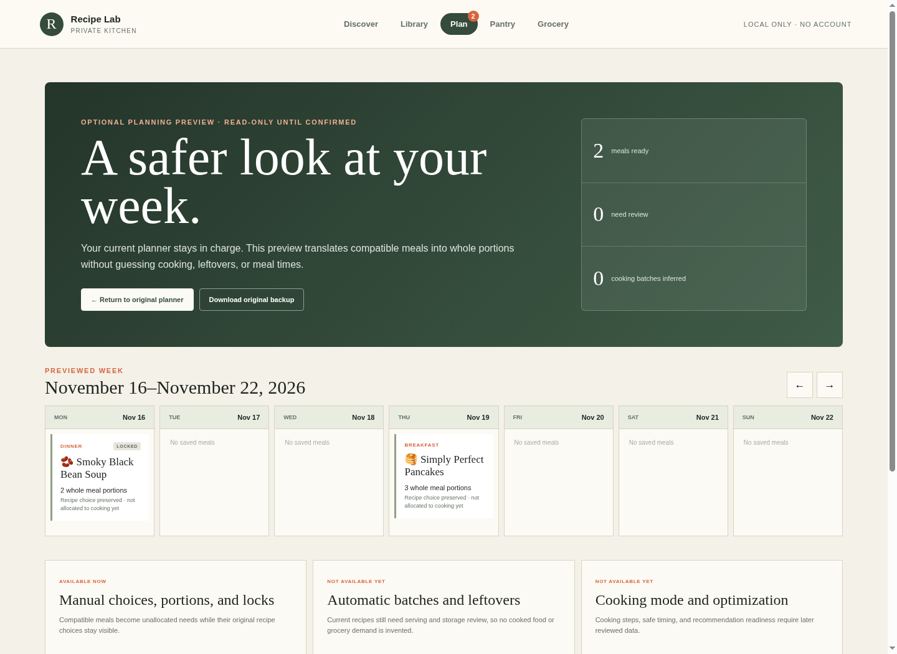
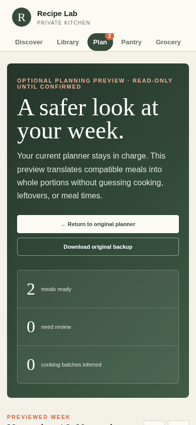

# V3 weekly planning preview and personal-data migration

## Status and boundary

Recipe Lab now has an opt-in preview of the v3 weekly planning model and a safe, browser-local compatibility snapshot. The original planner remains the default and continues to be the only live planning and grocery source. The preview does not activate cooking batches, leftovers, prepared-food inventory, automatic recommendations, or v3 grocery behavior.

Implementation files:

- `src/domain/personalDataV3.ts` — versioned schema, deterministic migration preview, validation, import/export, and separate-key persistence.
- `src/domain/personalDataV3.test.ts` — preservation, determinism, invalid-data, recovery, and storage regressions.
- `src/components/V3PlannerPreview.tsx` — opt-in weekly review and explicit save flow.
- `src/App.test.tsx` — user-flow regressions proving that the v2 planner stays authoritative.

## Implemented personal-data contract

`PersonalDataV3` retains the complete v2 personal-data shape and exact semantics for preferences, original plan slots, checked groceries, and pantry lots. It adds validated collections for:

- meal requirements;
- cook events and batches;
- meal allocations;
- prepared-food lots;
- preparation tasks;
- legacy recipe choices; and
- migration recovery metadata.

The new collections use the existing v3 planning schemas and referential-integrity checks. A legacy recipe choice records only which recipe was selected for the original slot. It is not a cook event, batch, allocation, or claim that food exists.

## Deterministic compatibility rules

The preview accepts validated v2 personal data, an IANA time zone, and the known recipe IDs. Identical inputs produce byte-identical JSON.

For every unambiguous legacy slot with a known recipe and whole-number servings, it:

1. preserves the original slot unchanged in both `plan` and `migrationRecovery.originalPayload`;
2. creates a stable `meal-requirement-legacy-*` identifier derived from the original slot ID;
3. maps the date, meal, requested whole portions, and lock;
4. leaves `intendedAt` unknown rather than inventing a time; and
5. stores the recipe as an unallocated `legacyRecipeChoice`.

It never infers cooking, leftovers, prepared inventory, or tasks. All of those collections start empty.

The preview quarantines rather than guesses when it encounters:

- fractional legacy servings;
- a recipe no longer present in the catalog;
- a repeated legacy slot ID; or
- more than one slot for the same date and meal.

The original slot remains recoverable and visible with a review message. Fractional values are not rounded.

## Persistence, coexistence, and recovery

The original app continues to read and write `recipe-lab.personal.v1`. A confirmed preview snapshot is validated first and then written to the independent `recipe-lab.personal.v3` key. The migration code never rewrites or deletes the v2 key.

Before saving, the UI offers an exact v2 backup and requires a review acknowledgement. Recovery metadata contains:

- the validated original v2 payload;
- a deterministic fingerprint of that payload;
- the source version and storage key;
- migration issues; and
- the explicit `v2-authoritative-v3-snapshot` coexistence policy.

If v2 changes after a snapshot was created, the saved v3 snapshot is marked stale. A stale preview cannot silently replace current data. Replacing any existing v3 snapshot is explicit. A validation, storage, or quota failure leaves v2 untouched; corrupt v3 text is surfaced for recovery instead of being treated as valid data.

`exportPersonalDataV3` validates before export. `importPersonalDataV3` parses and validates completely before returning a value, so callers can keep imports atomic by writing only after it succeeds. The current UI intentionally exposes the pre-migration v2 backup and snapshot creation, not a general v3 import or activation flow.

## Preview experience

The Plan screen opens the established planner by default. **Preview New Planner** opens a separate weekly view with:

- prior/next week navigation;
- preserved recipe, portion, and lock information;
- an explicit “recipe choice preserved · not allocated” state;
- migration issues beside affected legacy slots;
- a summary of what will and will not be created; and
- a direct route back to the original planner.

The preview is responsive for desktop and mobile and uses existing semantic controls and focus behavior. Saving the snapshot does not switch modes on the next visit.

## Readiness and unavailable capabilities

The existing 25 recipes remain manual-plan eligible through the v2 experience. They are not treated as v3 recommendation-ready, and this milestone does not create batch sizes, leftovers, cooking tasks, or prepared-food inventory for them.

Activating v3 planning later still requires a reviewed week-conversion flow in which the user chooses batch sizes and leftover relationships, followed by an explicit compatibility and rollback decision for any new v3-only planning data. Grocery demand and personal-data writes must not switch to v3 until that activation is separately reviewed.

## Verification

Browser evidence from the opt-in flow:

| Desktop | Mobile |
| --- | --- |
|  |  |

The captured runs use the real application at 1440×1050 and 390×844. Both verified week navigation, preserved choices and locks, explicit snapshot confirmation, an unchanged v2 storage record, an independent valid v3 record, zero inferred cooking entities, and no horizontal overflow.

Run the personal migration and app regressions with:

```sh
npx vitest run src/domain/personalDataV3.test.ts src/App.test.tsx
```

Run the complete repository gate with `npm run check`.
